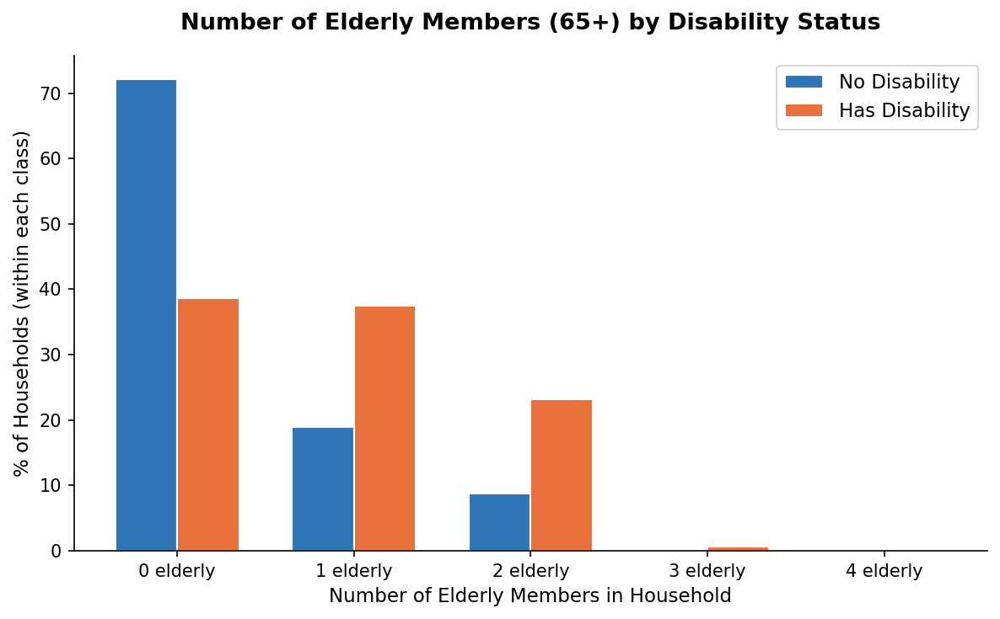
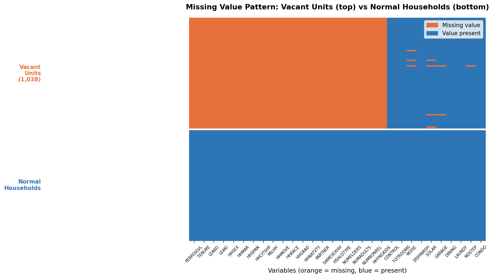

# Predicting Disability in American Households

**Data understanding and preprocessing on the 2023 American Housing Survey (9,241 households × 145 variables)**

> **TL;DR:** The goal is to predict whether a household includes someone with a disability, using U.S. Census housing-survey data. This phase focuses on data quality work that is easy to get wrong: **1,038 "households" turned out to be vacant units**, income is heavily skewed (so median imputation), and the **number of elderly members** is by far the strongest early signal.

 

## Findings

| | |
|:--|:--|
| **Hidden vacant units** | 40 columns shared exactly the same 1,038 missing rows. Those rows had no label and only 55 of 145 fields filled (vs 141 normally): vacant homes with nobody to interview. Removed. |
| **Class imbalance** | 76.6% No / 23.4% Yes after dropping 1,206 unlabelled rows, so later modelling needs balanced metrics, not accuracy |
| **Skew drives imputation** | Household income skewness is 13.7 (mean $105.8K vs median $75K), so medians are used instead of means |
| **Strongest signal** | Disability rate rises from **14.1%** with no elderly members to **37.6%** with one and **44.6%** with two |
| **Income gap** | Median income is **$50K** for disability households vs **$77K** for others |

  
  

## Code

| File | Purpose |
|:--|:--|
| `exploration.py` | Shape, class balance, missing-value audit, discovery of the vacant-unit pattern |
| `preprocessing.py` | Drops IDs and unlabelled rows, median/mode imputation, encoding |
| `charts.py` | All report figures (`figures/`) |

## Data

The [2023 American Housing Survey](https://www.census.gov/programs-surveys/ahs.html) from the U.S. Census Bureau, in a version prepared for the course (not redistributed here). Save it as `project_data.csv` to run the scripts.

Team project with <b>Jai Sharma</b> · Boston University MET CS 699 (Data Mining), Spring 2026 · 📄 <a href="report/intermediate_report.pdf">Intermediate report</a>
