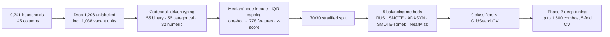

<div align="center">

# Predicting Disability in American Households

**70+ models on the 2023 American Housing Survey, and why undersampling beat SMOTE**


</div>

> **TL;DR:** Predict whether a U.S. household includes someone with a disability, from 144 Census survey variables, where only 23% of households are "Yes". Across **70+ configurations** (5 balancing methods × 9 classifiers × 3 tuning phases), **random undersampling + gradient boosting** won: it catches **73.6% of disability households** while correctly clearing **78.3% of the rest (ROC AUC 0.84)**. The surprise: SMOTE, ADASYN and SMOTE-Tomek all *failed*, and the reason is worth knowing.

<br>

## Results

| Model | Disability households caught (Yes TPR) | Others cleared (No TPR) | ROC AUC | MCC |
|:--|--:|--:|--:|--:|
| **Undersampling + Gradient Boosting** ⭐ | **73.6%** | **78.3%** | **0.842** | 0.465 |
| Undersampling + Random Forest (deep-tuned, 700 trees) | 73.3% | 76.7% | 0.836 | 0.443 |
| Undersampling + SVM | 72.2% | 79.9% | 0.832 | 0.472 |
| SMOTE + XGBoost | 46.7% | 97.1% | 0.841 | 0.550 |
| SMOTE + SVM | 37.7% | 99.0% | 0.780 | 0.529 |
| *Always predict "No"* | *0%* | *100%* | *0.5* | *0* |

Best model: `GradientBoostingClassifier(learning_rate=0.01, max_depth=4, n_estimators=200, subsample=0.8)` on a 1:1 random undersample. Confusion matrix on 2,411 held-out households: **416 / 565** disability households found, **1,445 / 1,846** others correctly cleared.

## Why SMOTE failed here

Oversampled models reached **95%+ No TPR but only 30–46% Yes TPR**, collapsing back toward the majority class.

- After one-hot encoding, the data has **778 mostly-binary features**. SMOTE interpolates between neighbours, producing fractional values (say 0.37 for a yes/no category) that no real household can have.
- Euclidean distance over one-hot categories is close to meaningless, so SMOTE's "nearest neighbours" aren't meaningfully similar households.
- The synthetic points make the training data look more separable than reality, and that separation doesn't hold up on real test data.

**Undersampling** keeps only real households. It throws away half the majority class but generalises far better, a counter-intuitive trade-off that the numbers make clear.

## Pipeline



**The data-quality catch that shaped everything:** after reading the 313-page AHS codebook, it turned out **72% of the "numeric" columns are really category codes** (e.g. `NOISE`: 1 = Yes, 2 = No). Scaling them as numbers would have silently corrupted every model, so each variable was typed by hand from the codebook.

## My contributions

This was a two-person project with [Jai Sharma](https://github.com/jai0812) ([team repo](https://github.com/jai0812/us-household-disability-prediction)). My parts:

- **Codebook analysis and variable typing:** read the codebook and classified all 143 features, which drove the encoding strategy
- **Preprocessing:** imputation, encoding and standardisation pipeline
- **Oversampling experiments:** SMOTE, ADASYN, SMOTE-75% and NearMiss models, including the analysis of *why* they failed
- **Deep tuning** of the Gradient Boosting and Random Forest models in phase 3
- **Early EDA scripts and figures** (`eda/`), the intermediate report, final-report writing and the slides

## Repo layout

```
src/preprocessing.py         standalone preprocessing
src/project_code.py          phase 1: preprocessing + all 36 models end to end
src/phase2_tuning.py         phase 2: NearMiss, SMOTE-75%, RUS seed variants, deeper grids
src/phase3_tuning.py         phase 3: deep GBM / RF tuning (5-fold CV)
data/project_data.csv        2023 AHS extract (9,241 households × 145 columns)
data/AHS_Dictionary_2023.pdf official codebook (313 pages) used to type every variable
outputs/                     preprocessed data + the exact 70/30 train/test split used
results/                     per-model metrics for phases 1 and 2
eda/  figures/               early exploration and charts
report/                      final report + intermediate reports
```

## Run it

```bash
pip install -r requirements.txt
cd src
cp ../data/project_data.csv .
python project_code.py         # preprocessing, train/test split, all 36 phase-1 models
python phase2_tuning.py        # phase 2 (reads the split written above)
python phase3_tuning.py        # phase 3 deep tuning (slow: up to 1,500 combos per model)
```

To skip preprocessing, copy `outputs/initial_train.csv` and `outputs/initial_test.csv` into `src/` and run phases 2 and 3 directly.

## What we'd do next

- **Balanced ensembles** (EasyEnsemble, BalancedRandomForest) to keep majority-class information that single undersampling throws away
- **Feature selection** on the 778-column space (mutual information, tree importance)
- **Threshold tuning:** the course fixed it at 0.5, but in practice moving it along the ROC curve is the cheapest improvement

<br>

<sub>Boston University MET CS 699 (Data Mining), Spring 2026 · Team: Kunj Patel & Jai Sharma · 📄 <a href="report/final_report.pdf">Final report</a> · <a href="report/intermediate_report_team.pdf">Intermediate report</a></sub>
